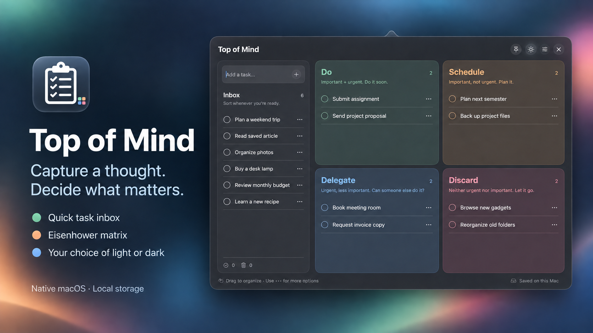
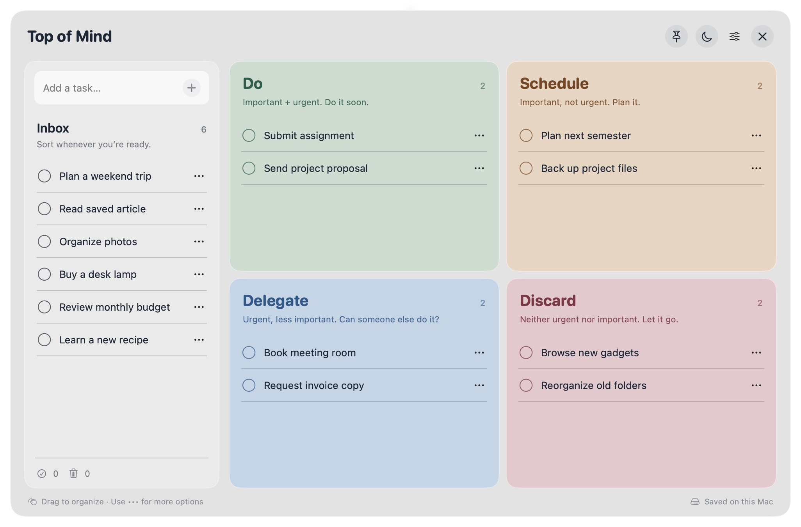
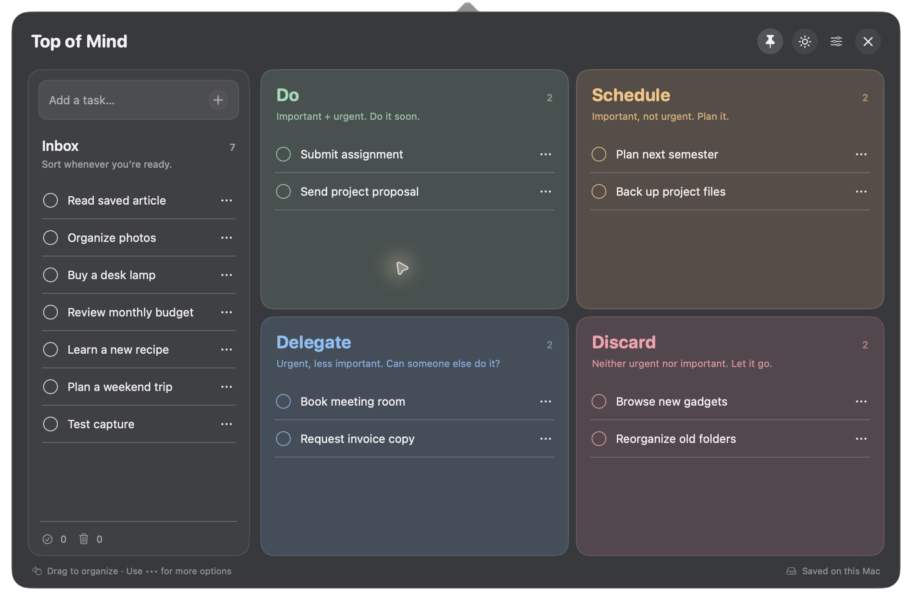

# Top of Mind

Capture a thought. Decide what matters.

A native macOS menu bar app with a quick task inbox and a spacious Eisenhower matrix. Open the little checklist in your menu bar, add a title, and sort your tasks whenever you're ready.

## Install

1. Download **TopOfMind-v0.1.0-macos-universal.zip** from [the latest release](https://github.com/fabi-wi/top-of-mind/releases/latest).
2. Unzip it and move **Top of Mind.app** into **Applications**.
3. Open the app and click the checklist in your menu bar.

**Requires macOS 14 or later.** The release includes Apple Silicon and Intel support. There is no Dock icon.

The current release is ad-hoc signed and is not Apple-notarized. On a downloaded copy, macOS may require you to allow the app in **System Settings → Privacy & Security → Open Anyway** after the first launch attempt. Only do this for a copy you trust. No security settings are changed by the app.

## A small inbox, a clear plan

- **Capture:** type in the left-hand inbox and press Return.
- **Organize:** drag tasks into a quadrant, or choose a destination from the task's `…` menu. Drag within a list to change its order.
- **Complete:** click a task's circle. Completed tasks stay available in history.
- **Reconsider:** move a task back to Inbox whenever its priority changes.
- **Trash:** deleted tasks stay in Trash and can be restored.
- **Choose your appearance:** use the sun/moon button beside the pin. Light and dark mode are chosen by you, independently of macOS.
- **Keep it open:** pin the panel while organizing. Unpin to dismiss it when clicking elsewhere.
- **Show matrix labels:** optional urgency/importance labels can be switched on from the app menu.

| Quadrant | Rule |
| --- | --- |
| **Do** | Important and urgent. Do it soon. |
| **Schedule** | Important, not urgent. Plan it. |
| **Delegate** | Urgent, less important. Could someone else handle it? |
| **Discard** | Neither urgent nor important. Consider letting it go. |

Putting a task in **Discard** does not delete it. Trash is a separate action.




The screenshots use illustrative tasks. Your first launch starts with an empty inbox.

## Local by design

No account, cloud sync, tracking, network requests, or external dependencies. Your tasks and preferences are saved locally as JSON at:

```text
~/Library/Application Support/Top of Mind/tasks.json
```

Writes are atomic. If the saved file cannot be read, the app preserves it and shows a recovery message instead of overwriting it. If a write fails, the change is not applied. Task contents are not printed to logs.

Quit the app before manually backing up or restoring the task file. Removing the app does not remove your tasks.

## Build from source

Install Apple's Command Line Tools or Xcode with Swift 6 or later, then:

```sh
git clone https://github.com/fabi-wi/top-of-mind.git
cd top-of-mind
swift test
./scripts/run.sh
```

To build an app bundle without opening it:

```sh
./scripts/build_app.sh
```

The bundle is created at `dist/Top of Mind.app`. To produce a universal release ZIP and SHA-256 checksum:

```sh
./scripts/package_release.sh 0.1.0
```

The app is written in SwiftUI and AppKit. Its Foundation-only core handles ordering, destinations, task history, and local persistence. The menu bar icon uses Apple's template SF Symbols and adapts to the menu bar's contrast; the app's theme remains your choice.

## License

[MIT](LICENSE).
